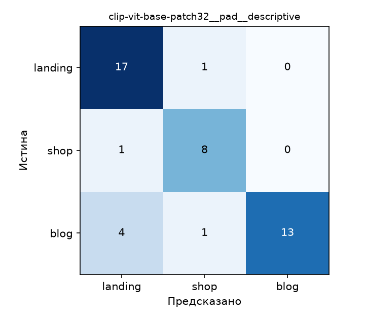

# Часть 1 — Классификация скриншотов сайтов

**Задача:** по изображению верхней части веб-страницы определить её тип: `landing`,
`shop` или `blog`. Вход — PNG/JPEG/WebP; выход — класс, score и softmax-оценки всех классов.
Критерий проекта — macro-F1 ≥ 0,70. Модель предобучена, дообучение не используется.

## Модель и варианты обработки

[CLIP ViT-B/32](https://huggingface.co/openai/clip-vit-base-patch32) сопоставляет
эмбеддинг картинки с текстовыми описаниями классов. Используются Transformers и PyTorch.
Сходства масштабируются обученным множителем CLIP и проходят softmax.
Эти значения **не являются калиброванными вероятностями правильности**.

Сравниваются `crop` (штатная обрезка CLIP) и `pad` (белые поля до квадрата),
три заранее заданных набора промптов: simple, descriptive и ensemble.
В ensemble усредняются нормированные текстовые эмбеддинги внутри каждого класса.
Основная конфигурация `pad + descriptive` зафиксирована до эксперимента и используется в API.

## Данные и проверка скриншотов

12 октября 2026 года собраны URL 73 страниц. Из них 56 загрузились, 17 дали ошибку
HTTP/таймаут/DNS. После визуального просмотра исключены ещё 11 снимков с заглушками,
незагрузившимся содержимым или перекрывающими окнами. **Итог: 45 скриншотов**:
18 landing, 9 shop, 18 blog. Метки заданы по назначению страниц до инференса.
Ни один снимок не исключался по ошибке классификатора.

Окно Chromium 1440×900, JPEG quality=85, снимается верх страницы. URL собраны напрямую
с сайтов; один магазин Books to Scrape — демонстрационный. Источники и язык записаны
в `data/urls.csv` и манифесте. После QA осталось 44 англоязычных сайта и один русскоязычный
(Tilda): данных недостаточно для сравнения языков. Основная доля лендингов — SaaS,
блогов — технологические публикации, магазинов — книги, одежда и электроника.

`data/manifest.csv` сохраняет HTTP-статус, финальный URL, время UTC, SHA256 и решение QA.
Принятые изображения включены в репозиторий для повторения **той же** оценки.
Они используются как учебные примеры интерфейсов; права на содержимое и бренды
принадлежат соответствующим владельцам. Неудачные попытки и причины исключения сохранены
в манифесте, сами отбракованные снимки в Git не включены.

## Запуск

Из корня проекта:

```bash
python3.11 -m venv .venv
source .venv/bin/activate
pip install -r requirements-dev.txt
python -m image.evaluate
python -m image.clip_classifier image/data/images/shop/2ec30ac0f31ed5df.jpg
```

Первая загрузка весов CLIP занимает около 600 МБ. CPU, MPS и CUDA выбираются автоматически.
Допускается также `cd image && python evaluate.py`.

Повторный сбор (живые сайты могут измениться):

```bash
playwright install chromium
python -m image.capture_screenshots --limit 5
python -m image.capture_screenshots
```

При новом сборе все кадры получают `qa=pending`. Просмотрите снимки и заполните
`qa=accept/reject` и `qa_note` в манифесте: в оценку входят только `accept`.
`--force` переснимает существующие страницы. Имена файлов основаны на SHA256 URL,
поэтому перестановка строк не подменяет кеш; `--limit` не стирает остальные записи.
Манифест сохраняется после каждой попытки. Не обходите капчи: исключайте такие страницы.

## Результаты

| Обработка | Промпты | Accuracy | Macro-F1 |
|---|---|---:|---:|
| pad | ensemble | 0.8667 | 0.8667 |
| crop | descriptive | 0.8444 | 0.8500 |
| **pad** | **descriptive — основная** | **0.8444** | **0.8436** |
| crop | ensemble | 0.8444 | 0.8430 |
| crop | simple | 0.7778 | 0.7778 |
| pad | simple | 0.7556 | 0.7525 |

Основной вариант: 38 верных ответов из 45, accuracy 95% ДИ [0,7333; 0,9333],
macro-F1 95% ДИ [0,7159; 0,9363] (bootstrap, 1000 повторов, seed=42).
Критерий 0,70 выполнен. Лучший вариант выбран по этой же выборке, поэтому 0,8667
является исследовательским результатом; для его независимого подтверждения нужен новый набор.

| Класс | Precision | Recall | F1 | N |
|---|---:|---:|---:|---:|
| landing | 0.7727 | 0.9444 | 0.8500 | 18 |
| shop | 0.8000 | 0.8889 | 0.8421 | 9 |
| blog | 1.0000 | 0.7222 | 0.8387 | 18 |



| Порог score | Доля сохранённых ответов | Accuracy |
|---:|---:|---:|
| 0.0 | 100.00% | 84.44% |
| 0.5 | 93.33% | 88.10% |
| 0.7 | 75.56% | 97.06% |
| 0.9 | 44.44% | 95.00% |

При пороге 0,7 точность растёт, но четверть страниц остаётся без ответа.
Порог исследован на том же наборе и не включён автоматически в API.

## Ошибки и ограничения

Семь ошибок основного варианта сохранены в `results/errors_*pad__descriptive.csv`.
Cloudflare, Seth's Blog, Stack Overflow и CSS-Tricks определены как landing:
вверху страницы крупные заголовки и иллюстрации похожи на рекламу продукта.
Ed Zitron's блог распознан как shop (в кадре видны платные подписки),
SparkFun — как landing (крупные рекламные блоки), Tilda — как shop.
Это объяснения по визуальным признакам, не измерение внутренних причин модели.
Ошибка Stack Overflow получила score 0,9196: высокий softmax не гарантирует правильность.

Выборка мала и несбалансирована, магазинов всего девять. Сайты отбирались вручную,
а блокировки сузили набор доступных магазинов. Две страницы принадлежат Notion,
что уменьшает независимость примеров. Разбиения на train/test нет, поскольку веса
и промпты не обучались на этих изображениях; сравнение конфигураций всё же использует
общую оценочную выборку. Качество на иных доменах и языках не установлено.
Мелкий текст теряется при уменьшении до 224×224. Модель принудительно выбирает один
из трёх классов даже для неподходящей страницы. Скорость в comparison.csv относится
к кодированию изображений пакетами, а не ко всему HTTP-запросу.

Все шесть конфигураций имеют JSON метрик, CSV предсказаний/ошибок и матрицу ошибок.
