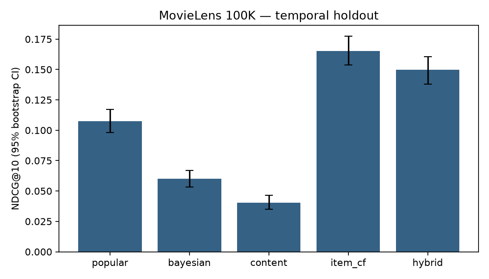
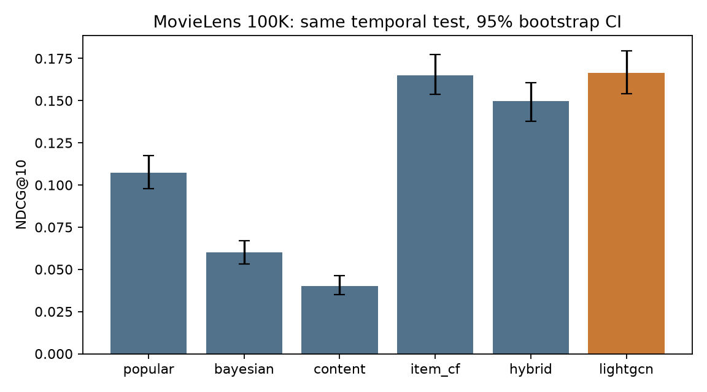
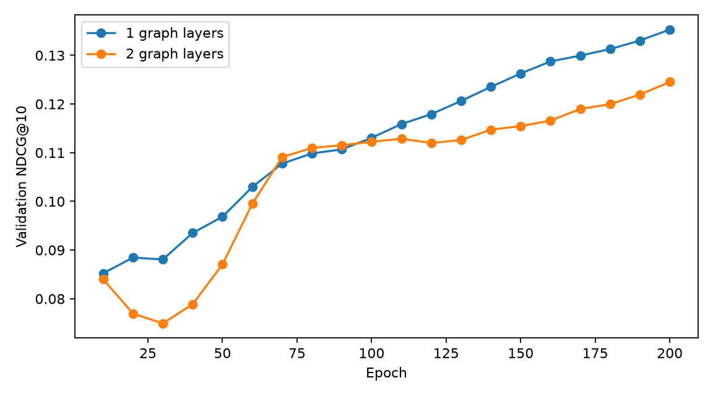

# Часть 3 — Рекомендации фильмов

Учебный сервис подбирает пользователю десять ещё не оценённых фильмов.
Данные: [MovieLens 100K, GroupLens](https://grouplens.org/datasets/movielens/100k/),
100 000 оценок, 943 пользователя, 1 682 фильма. Возраст, пол и профессии пользователей
не используются. Исходный набор скачивается отдельно с соблюдением условий его README.

## Запуск

Из корня репозитория после установки `requirements.txt`:

```bash
python -m recsys.download_data
python -m recsys.evaluate
python -m recsys.recommender --user 1 --method item_cf --k 10
python -m recsys.recommender --user 99999 --method item_cf
```

Последняя команда демонстрирует холодный старт нового пользователя: fallback на популярность.

## Реализованные подходы

| Метод | Принцип |
|---|---|
| popular | Количество положительных оценок (4–5) в train |
| bayesian | Средняя оценка со сглаживанием 20 псевдооценками, равными среднему train |
| content | TF-IDF по 19 жанровым признакам, средний профиль понравившихся фильмов, cosine similarity |
| item_cf | Cosine similarity столбцов пользователь–фильм по положительным оценкам; 40 соседей каждого фильма |
| hybrid | Среднее нормированных content и item_cf scores, вес 0,5 задан до эксперимента |

Классические подходы реализованы с NumPy, SciPy и scikit-learn; эвристики не требуют
сложной модели. Просмотренными считаются **все** фильмы с оценкой в train, включая
отрицательные. Для неизвестного пользователя и истории без положительных оценок
персонализированные методы переходят к popular. Жанры позволяют content рекомендовать
фильм без оценок; collaborative такой информации не имеет.

## Протокол оценки

- Для каждого пользователя последние 20% оценок по времени отложены в test. Все оценки
  с одинаковым временем остаются вместе; фактическое разделение 78 595 / 21 405.
- Если у пользователя единственная временная отметка, его история остаётся в train.
- Релевантными считаются test-фильмы с оценкой не ниже 4. Таких пользователей 915;
  остальные 28 не входят в среднее ranking-метрик.
- Кандидаты — весь каталог минус история train, без выборки «лёгких» отрицательных объектов.
- Все популярности, средние рейтинги и collaborative similarities рассчитаны только по train.
  TF-IDF использует жанры полного заранее известного каталога (доступность каталога — предположение).
- Это разделение по времени **внутри пользователя**, не глобальная симуляция сервиса:
  история одного пользователя может быть позже test-событий другого. Для production-вывода
  нужен эксперимент с единым временным срезом и учётом даты появления фильма в каталоге.
- 71 test-фильм отсутствует в train; на них приходится 17 положительных test-пар.
  Дополнительно сохраняется warm NDCG на 914 пользователях с известными релевантными фильмами.
- Precision@10 = hits / 10, Recall@10 = hits / число релевантных, DCG использует
  скидку 1/log2(rank+1), NDCG нормируется идеальным списком, AP@10 делится на min(10, relevant).
  Отсутствие оценки трактуется как отсутствие наблюдаемой релевантности, а не как dislike.
- 95% интервалы NDCG: bootstrap по пользователям, 1000 повторов, seed=42.
  Для разности с popular применяется парный bootstrap. Это интервалы на фиксированном split,
  а не оценка вариации при переобучении или переносе на другую аудиторию.

## Полученные результаты

| Метод | Precision@10 | Recall@10 | NDCG@10 | MAP@10 | Hit rate@10 | Покрытие каталога |
|---|---:|---:|---:|---:|---:|---:|
| popular | 0.0867 | 0.0752 | 0.1073 | 0.0524 | 0.4426 | 4.46% |
| bayesian | 0.0568 | 0.0485 | 0.0601 | 0.0249 | 0.3388 | 3.57% |
| content | 0.0328 | 0.0304 | 0.0403 | 0.0160 | 0.2404 | 28.18% |
| item_cf | **0.1263** | **0.1310** | **0.1651** | **0.0876** | 0.5825 | 14.51% |
| hybrid | 0.1142 | 0.1182 | 0.1497 | 0.0773 | **0.5891** | 25.68% |

Item-CF повышает NDCG относительно popular примерно на 53,8%;
парная разность +0,0578, 95% ДИ [0,0486; 0,0679]. Гибрид охватывает больше каталога,
но уступает item_cf в NDCG. Жанров недостаточно для точной персонализации:
content имеет наибольшее покрытие, но самое низкое NDCG.
Параметры не подбирались по test. Результаты пяти заранее заданных конфигураций
приведены целиком; выбор победителя на этом же test требует последующей независимой проверки.



## Ограничения и уязвимости

1. **Холодный старт.** Новый пользователь получает popular; новому фильму помогают жанры.
   Нужны стартовый выбор интересов и контролируемая доля новых объектов.
2. **Популярностное смещение.** Baseline рекомендует малую долю каталога. Нужно следить за
   покрытием, разнообразием и доступностью рекомендаций для редких жанров.
3. **Манипуляция оценками.** Группа подставных пользователей может продвинуть фильм.
   Возможные меры: лимиты, дедупликация событий, оценка доверия и поиск аномалий;
   в данном offline-прототипе эти меры не реализованы и атаки не моделировались.
4. **Разреженность и ложная отрицательная связь.** Неоценённый фильм может понравиться;
   логи просмотра и показов улучшат оценку. Нужны exposure-aware метрики и online-тест.
5. **Устаревшие данные и дрейф.** Оценки 1997–1998 годов не отражают современный каталог.
   Нужны свежие данные, временной вес и мониторинг качества.
6. **Приватность.** Для сервиса нужны согласие, минимизация хранения истории и удаление
   данных по запросу. В эксперименте применяются анонимные ID учебного набора.
7. **Масштабирование.** Матрица item similarity строится плотной: память O(I²),
   поэтому для миллионов фильмов нужен разреженный kNN/ANN или факторизация.

## Ожидаемый эффект для бизнеса и проверка

Гипотеза — более релевантные рекомендации повысят долю запусков фильма и удержание.
Offline-рост NDCG **не доказывает** рост CTR, выручки или удержания.
Предлагаемый A/B-тест: рандомизация по пользователю, контроль popular против item_cf,
основная метрика — доля запусков из рекомендательного блока; дополнительные — время просмотра,
возврат через 7 дней, покрытие и latency p95. Заранее определить минимально полезный эффект,
размер выборки, срок и правила остановки; фильтровать технические сбои одинаково для групп.
При отрицательном результате использовать popular как резервный алгоритм.

Результаты, доверительные интервалы, примеры пользователя 1, cold-start и SHA256 архива
находятся в `results/`. Тесты в `tests/test_recsys.py` проверяют разделение данных,
метрики на известном примере, исключение просмотренного, уникальность и fallback.

## Усложнённая часть: GNN — LightGCN

Добавлена отдельная модель `lightgcn.py`. Предыдущие пять методов и результаты
в `results/` сохранены. Новый эксперимент записывается в `results/advanced/`.

### Какие подходы рассмотрены

| Подход | Как работает | Что подходит нашему примеру | Основная сложность |
|---|---|---|---|
| Two-Tower | Одна сеть кодирует пользователя/запрос, другая — фильм; близость векторов задаёт кандидатов | Можно добавить жанры и описания, заранее посчитать векторы фильмов | Нужно согласованно обновлять модель и поисковый индекс; приближённый поиск теряет часть кандидатов |
| GNN / LightGCN | Векторы передаются по рёбрам графа пользователь–фильм, затем усредняются по слоям | В MovieLens уже есть граф взаимодействий; можно обучить на CPU | Без истории нет соседей; изменение графа требует обновления векторов |
| Языковая модель / P5 | Задачи рекомендаций, истории и метаданные переводятся в текст и решаются общей text-to-text моделью | Можно учитывать описания и текстовые запросы | Дороже обучение и ответ; генерацию ID нужно ограничивать каталогом и отдельно проверять |

Источники исследования:

1. [Google Cloud, Two-Tower retrieval](https://docs.cloud.google.com/architecture/implement-two-tower-retrieval-large-scale-candidate-generation)
   — архитектура с раздельным вычислением пользовательских и предметных векторов,
   предрасчётом каталога и ANN-поиском. Документ проверен авторами 16.01.2025.
2. [He et al., LightGCN, SIGIR 2020](https://arxiv.org/abs/2002.02126)
   — модель оставляет нормированное распространение по графу, убирает нелинейные
   активации и матрицы преобразований; итог — сумма представлений разных слоёв.
   [Авторская реализация PyTorch](https://github.com/gusye1234/LightGCN-PyTorch).
3. [Geng et al., P5, RecSys 2022](https://arxiv.org/abs/2203.13366)
   — общий языковой формат для нескольких рекомендательных задач и персональные
   prompts. Это пример языкового подхода; он здесь изучен, но не обучался.

Источники просмотрены 17.11.2026. Это сравнение трёх направлений из задания,
а не утверждение, что LightGCN — самая новая или лучшая модель на сегодня.
Для реализации выбран LightGCN: он не требует внешнего LLM-сервиса и позволяет
разобрать графовую модель на том же наборе, что и классические алгоритмы.
Код написан по формулам статьи; это небольшая реализация для MovieLens, а не
перенос всего авторского фреймворка или воспроизведение всех экспериментов статьи.

### Что обучается

Положительное ребро — оценка 4 или 5 **только из текущего train**. Граф двудольный:
943 пользовательских узла и 1 682 узла фильмов. На каждом слое:

```text
E(0) — обучаемые векторы ID размерности 32
A_norm = D^(-1/2) A D^(-1/2)
E(l+1) = A_norm E(l)
E_final = mean(E(0), ..., E(L))
score(u, i) = dot(E_final[u], E_final[i])
```

Обучение использует BPR: положительный фильм должен получить score выше
случайного неоценённого. Отрицательный пример выбирается из фильмов, отсутствующих
во всей истории текущего train-пользователя. Он не является доказанным dislike.
Низкие оценки не становятся положительными рёбрами и исключаются из рекомендаций.
Один полный BPR-batch на эпоху, Adam, learning rate 0,01, L2=0,0001, seed=42.
Веса изолированных узлов обнуляются; неизвестному пользователю и пользователю
без положительной истории выдаётся popular. Фильмы без положительных рёбер
оказываются в конце списка: GNN не умеет оценить их по содержанию.

### Запуск и честное разделение

```bash
# Данные нужны только для повторного обучения, не для загрузки checkpoint.
python -m recsys.download_data
python -m recsys.evaluate_advanced
python -m recsys.lightgcn --user 1 --k 10
python -m recsys.lightgcn --user 99999 --k 10
python -m pytest tests/test_recsys.py tests/test_lightgcn.py -q
```

Для интеграции:

```python
from recsys.lightgcn import LightGCNRecommender, DEFAULT_CHECKPOINT

model = LightGCNRecommender.load(DEFAULT_CHECKPOINT)
print(model.titles(model.recommend(user_id=1, k=10)))
```

Внешнее разделение совпадает с базовой частью: 78 595 train / 21 405 test.
Из внешнего train выделяется ещё один временной validation по тому же правилу.
Число слоёв (1 или 2) и эпоха выбираются **только** по validation NDCG@10:
проверка раз в 10 эпох, остановка после четырёх проверок без улучшения,
максимум 200 эпох. После выбора модель обучается заново на всём внешнем train
до выбранной эпохи. Все шесть алгоритмов оцениваются на одинаковых 915
пользователях и одном полном каталоге. Test не передаётся в процедуру обучения.

Выбор ограничен двумя заранее заданными конфигурациями и одним seed.
Один и тот же внешний test уже использовался в базовой части, поэтому это
контролируемое учебное сравнение; окончательные выводы нужны на новом периоде.
Результаты фиксируются вместе с SHA256 исходных оценок и checkpoint,
версиями Python/PyTorch, длительностью обучения и полной кривой loss/validation.

### Результаты запуска 17.11.2026

| Метод | Precision@10 | Recall@10 | NDCG@10 | MAP@10 | Покрытие |
|---|---:|---:|---:|---:|---:|
| popular | 0,0867 | 0,0752 | 0,1073 | 0,0524 | 4,46% |
| bayesian | 0,0568 | 0,0485 | 0,0601 | 0,0249 | 3,57% |
| content | 0,0328 | 0,0304 | 0,0403 | 0,0160 | 28,18% |
| item_cf | 0,1263 | 0,1310 | 0,1651 | 0,0876 | 14,51% |
| hybrid | 0,1142 | 0,1182 | 0,1497 | 0,0773 | 25,68% |
| **lightgcn** | **0,1330** | **0,1351** | **0,1664** | **0,0902** | **27,76%** |

Validation выбрал один слой и 200 эпох: NDCG@10=0,1353; у двух слоёв — 0,1245.
Оба запуска достигли установленного лимита 200 эпох, ранняя остановка не сработала.
Поэтому найден лучший результат среди проверенных эпох, а не доказан оптимум обучения.
Внутреннее разделение: 61 566 fit / 17 029 validation; 911 пользователей с
положительными validation-оценками. Финальный граф содержит 44 969 положительных рёбер.

Разность NDCG LightGCN против popular: +0,0591, 95% парный bootstrap-интервал
[0,0470; 0,0713]. Против item_cf: +0,00135, интервал [−0,00891; 0,01070].
Уверенного преимущества GNN над item_cf по NDCG в этом опыте нет. Зато покрытие
выше: 27,76% против 14,51%. На данном наборе усложнение модели дало небольшой
прирост средней точности и больше разных фильмов; это не основание автоматически
заменять простой алгоритм в production.

Весь эксперимент занял 52,5 с; итоговое обучение на внешнем train — 10,55 с.
Замер на macOS ARM64, CPU, один поток PyTorch. Среднее время готового
`recommend` — 0,514 мс, p95 — 0,541 мс. Это последовательные локальные вызовы
на маленьком каталоге: без HTTP, конкуренции запросов и загрузки checkpoint.




В `results/advanced/` находятся checkpoint `lightgcn.pth`, `comparison.csv`,
`per_user_metrics.csv`, `paired_comparison.json`, `training_history.csv`,
`selection.json`, `protocol.json`, два графика и примеры выдачи.
Три новых теста проверяют нормировку и распространение на графе с ручным
ответом, negative sampling без просмотренного, обучение/холодный старт и
сохранение-загрузку checkpoint. Вместе с базовой частью — 14 пройденных тестов RecSys.

### Ограничения LightGCN и работа сервиса

| Проблема | Возможное решение | Цена решения / решение для прототипа |
|---|---|---|
| Новый пользователь или фильм | Опрос, контентные признаки, часть показов новым фильмам | Опрос увеличивает трение; жанры не заменяют историю. Здесь новый пользователь получает popular |
| Подставные оценки, продвижение фильма | Лимиты событий, доверие к аккаунту, контроль изменения степеней графа | Ошибочные блокировки новых активных зрителей. Защита и атаки экспериментально здесь не реализованы |
| Популярные узлы получают больше сигналов | Диверсификация выдачи и контроль long-tail покрытия | Может уменьшиться точность; фиксировать компромисс до A/B-теста |
| Много слоёв сглаживает различия пользователей | Ограничить число слоёв, сравнить на validation | Меньше дальних связей; здесь сравниваются 1 и 2 слоя |
| Поведение меняется, векторы устаревают | Периодическое переобучение, новые события, контроль свежести | Стоимость обучения и риск неудачного обновления; хранить предыдущую версию для отката |
| Большой каталог и задержка | Предрасчёт embeddings, ANN и последующее ранжирование | Индекс занимает память и требует синхронизации; здесь точный поиск по 1 682 фильмам |
| Фильмы недоступны или есть возрастные ограничения | Проверки каталога перед показом, ограничения по контексту | После фильтрации список может стать короче; нужны запасные кандидаты. В MovieLens таких признаков нет |
| Зависимость от наблюдавшихся оценок | Логи показов и просмотров, online-проверка | Сбор данных и приватность; незнакомый фильм в offline-метрике может быть полезным, но считаться промахом |

Для более крупного набора нужно заменить полную boolean-матрицу для negative
sampling на множества/CSR и пакетную выборку: эта учебная реализация хранит её
в памяти. Граф в PyTorch разреженный, матрица item–item для LightGCN не строится.
При HTTP-запросе используются готовые embeddings; обучение в обработчике не запускается.

### Что мониторить после внедрения

Следующий план — предложение для реального сервиса; production и A/B-тест
в рамках работы не запускались.

| Группа | Метрика и способ расчёта | Как использовать |
|---|---|---|
| ML | NDCG@10 и Recall@10 на отложенных новых событиях | Считать по пользователям с релевантными событиями; сравнивать с popular и предыдущей версией |
| ML | Покрытие каталога, доля новых/редких фильмов, концентрация показов | Проверять по дням и жанрам, чтобы среднее качество не скрывало однообразие |
| Данные | Доля cold-start, число новых событий, доля дублей/ошибок, возраст модели | Выявлять остановку поступления событий и аномальную активность |
| Сервис | HTTP error rate, latency p95/p99, доля fallback, доля коротких списков | Сигнализировать о сбоях; при проблеме откатывать модель или включать popular |
| Бизнес | CTR = клики / показы блока; запуск фильма = старты / показы | В A/B-тесте сравнивать группы, рандомизированные по пользователю |
| Бизнес | Время просмотра на пользователя и возврат через 7 дней | Проверять полезность после клика, а также ограничения по отказам/жалобам |

Сначала нужен период наблюдения для нормальных диапазонов. Порог оповещения
и минимально полезный эффект A/B-теста задаются заранее с учётом трафика.
Рост NDCG сам по себе не означает роста удержания или выручки.
