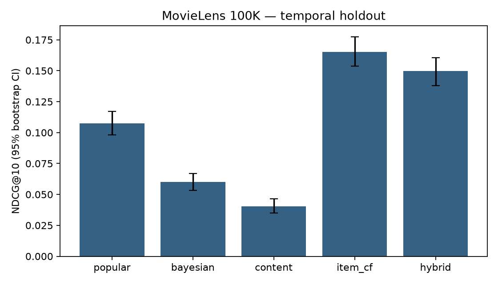

# Часть 3 — Рекомендации фильмов

Учебный сервис подбирает пользователю десять ещё не оценённых фильмов.
Данные: [MovieLens 100K, GroupLens](https://grouplens.org/datasets/movielens/100k/),
100 000 оценок, 943 пользователя, 1 682 фильма. Возраст, пол и профессии пользователей
не используются. Исходный набор скачивается отдельно с соблюдением условий его README.

## Запуск

Из корня репозитория после установки `requirements.txt`:

```bash
python -m recsys.download_data
python -m recsys.evaluate
python -m recsys.recommender --user 1 --method item_cf --k 10
python -m recsys.recommender --user 99999 --method item_cf
```

Последняя команда демонстрирует холодный старт нового пользователя: fallback на популярность.

## Реализованные подходы

| Метод | Принцип |
|---|---|
| popular | Количество положительных оценок (4–5) в train |
| bayesian | Средняя оценка со сглаживанием 20 псевдооценками, равными среднему train |
| content | TF-IDF по 19 жанровым признакам, средний профиль понравившихся фильмов, cosine similarity |
| item_cf | Cosine similarity столбцов пользователь–фильм по положительным оценкам; 40 соседей каждого фильма |
| hybrid | Среднее нормированных content и item_cf scores, вес 0,5 задан до эксперимента |

Классические подходы реализованы с NumPy, SciPy и scikit-learn; эвристики не требуют
сложной модели. Просмотренными считаются **все** фильмы с оценкой в train, включая
отрицательные. Для неизвестного пользователя и истории без положительных оценок
персонализированные методы переходят к popular. Жанры позволяют content рекомендовать
фильм без оценок; collaborative такой информации не имеет.

## Протокол оценки

- Для каждого пользователя последние 20% оценок по времени отложены в test. Все оценки
  с одинаковым временем остаются вместе; фактическое разделение 78 595 / 21 405.
- Если у пользователя единственная временная отметка, его история остаётся в train.
- Релевантными считаются test-фильмы с оценкой не ниже 4. Таких пользователей 915;
  остальные 28 не входят в среднее ranking-метрик.
- Кандидаты — весь каталог минус история train, без выборки «лёгких» отрицательных объектов.
- Все популярности, средние рейтинги и collaborative similarities рассчитаны только по train.
  TF-IDF использует жанры полного заранее известного каталога (доступность каталога — предположение).
- Это разделение по времени **внутри пользователя**, не глобальная симуляция сервиса:
  история одного пользователя может быть позже test-событий другого. Для production-вывода
  нужен эксперимент с единым временным срезом и учётом даты появления фильма в каталоге.
- 71 test-фильм отсутствует в train; на них приходится 17 положительных test-пар.
  Дополнительно сохраняется warm NDCG на 914 пользователях с известными релевантными фильмами.
- Precision@10 = hits / 10, Recall@10 = hits / число релевантных, DCG использует
  скидку 1/log2(rank+1), NDCG нормируется идеальным списком, AP@10 делится на min(10, relevant).
  Отсутствие оценки трактуется как отсутствие наблюдаемой релевантности, а не как dislike.
- 95% интервалы NDCG: bootstrap по пользователям, 1000 повторов, seed=42.
  Для разности с popular применяется парный bootstrap. Это интервалы на фиксированном split,
  а не оценка вариации при переобучении или переносе на другую аудиторию.

## Полученные результаты

| Метод | Precision@10 | Recall@10 | NDCG@10 | MAP@10 | Hit rate@10 | Покрытие каталога |
|---|---:|---:|---:|---:|---:|---:|
| popular | 0.0867 | 0.0752 | 0.1073 | 0.0524 | 0.4426 | 4.46% |
| bayesian | 0.0568 | 0.0485 | 0.0601 | 0.0249 | 0.3388 | 3.57% |
| content | 0.0328 | 0.0304 | 0.0403 | 0.0160 | 0.2404 | 28.18% |
| item_cf | **0.1263** | **0.1310** | **0.1651** | **0.0876** | 0.5825 | 14.51% |
| hybrid | 0.1142 | 0.1182 | 0.1497 | 0.0773 | **0.5891** | 25.68% |

Item-CF повышает NDCG относительно popular примерно на 53,8%;
парная разность +0,0578, 95% ДИ [0,0486; 0,0679]. Гибрид охватывает больше каталога,
но уступает item_cf в NDCG. Жанров недостаточно для точной персонализации:
content имеет наибольшее покрытие, но самое низкое NDCG.
Параметры не подбирались по test. Результаты пяти заранее заданных конфигураций
приведены целиком; выбор победителя на этом же test требует последующей независимой проверки.



## Ограничения и уязвимости

1. **Холодный старт.** Новый пользователь получает popular; новому фильму помогают жанры.
   Нужны стартовый выбор интересов и контролируемая доля новых объектов.
2. **Популярностное смещение.** Baseline рекомендует малую долю каталога. Нужно следить за
   покрытием, разнообразием и доступностью рекомендаций для редких жанров.
3. **Манипуляция оценками.** Группа подставных пользователей может продвинуть фильм.
   Возможные меры: лимиты, дедупликация событий, оценка доверия и поиск аномалий;
   в данном offline-прототипе эти меры не реализованы и атаки не моделировались.
4. **Разреженность и ложная отрицательная связь.** Неоценённый фильм может понравиться;
   логи просмотра и показов улучшат оценку. Нужны exposure-aware метрики и online-тест.
5. **Устаревшие данные и дрейф.** Оценки 1997–1998 годов не отражают современный каталог.
   Нужны свежие данные, временной вес и мониторинг качества.
6. **Приватность.** Для сервиса нужны согласие, минимизация хранения истории и удаление
   данных по запросу. В эксперименте применяются анонимные ID учебного набора.
7. **Масштабирование.** Матрица item similarity строится плотной: память O(I²),
   поэтому для миллионов фильмов нужен разреженный kNN/ANN или факторизация.

## Ожидаемый эффект для бизнеса и проверка

Гипотеза — более релевантные рекомендации повысят долю запусков фильма и удержание.
Offline-рост NDCG **не доказывает** рост CTR, выручки или удержания.
Предлагаемый A/B-тест: рандомизация по пользователю, контроль popular против item_cf,
основная метрика — доля запусков из рекомендательного блока; дополнительные — время просмотра,
возврат через 7 дней, покрытие и latency p95. Заранее определить минимально полезный эффект,
размер выборки, срок и правила остановки; фильтровать технические сбои одинаково для групп.
При отрицательном результате использовать popular как резервный алгоритм.

Результаты, доверительные интервалы, примеры пользователя 1, cold-start и SHA256 архива
находятся в `results/`. Тесты в `tests/test_recsys.py` проверяют разделение данных,
метрики на известном примере, исключение просмотренного, уникальность и fallback.
